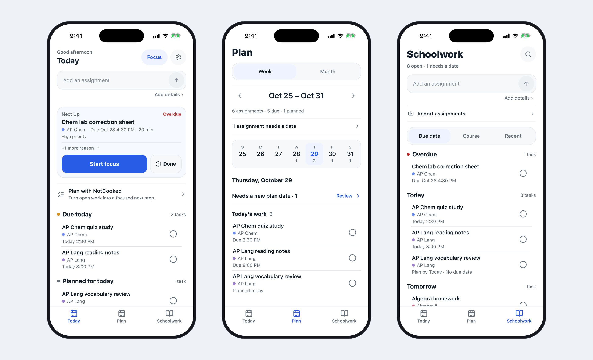
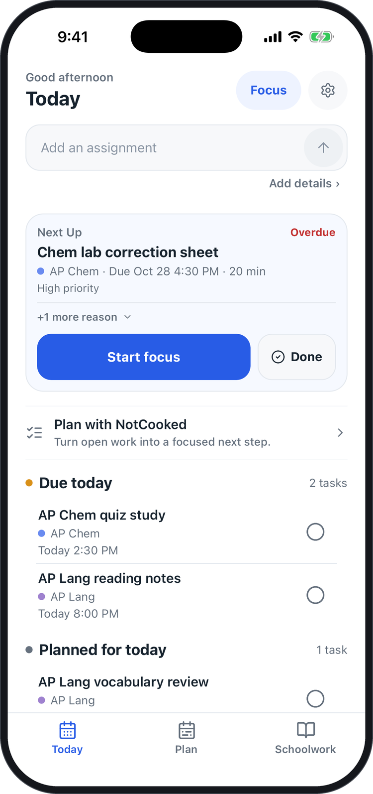
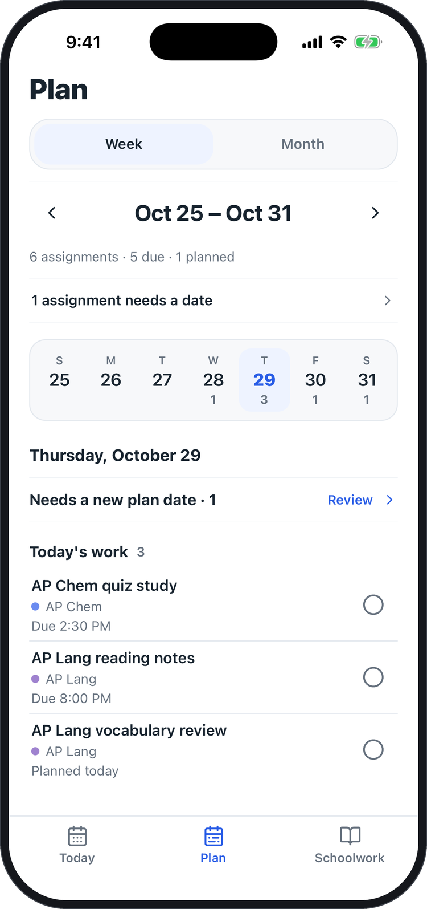
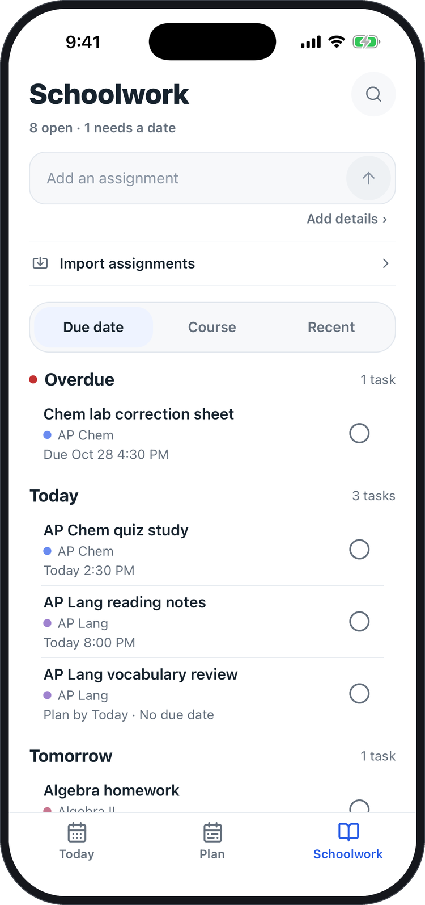
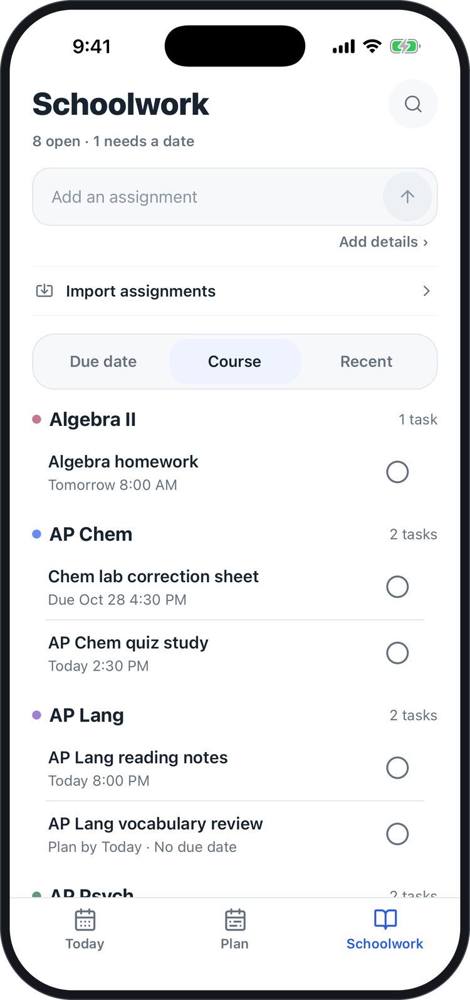
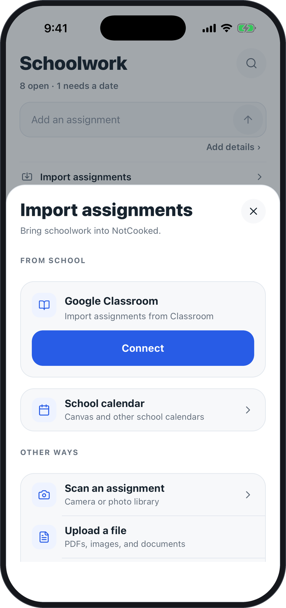
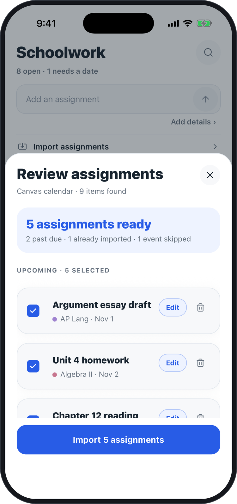
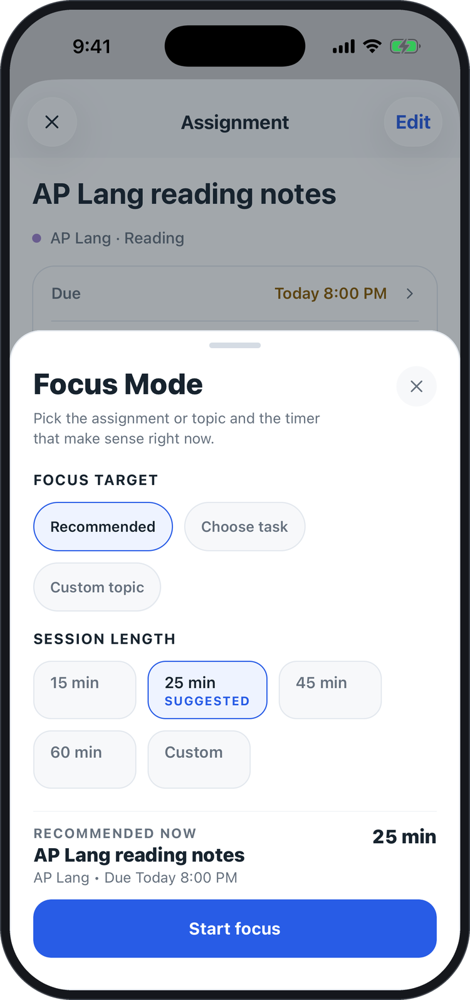
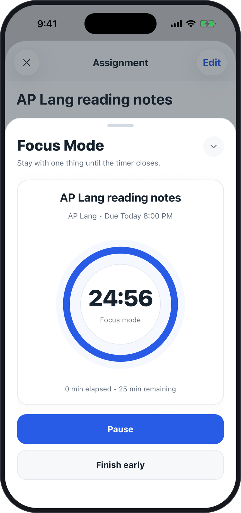
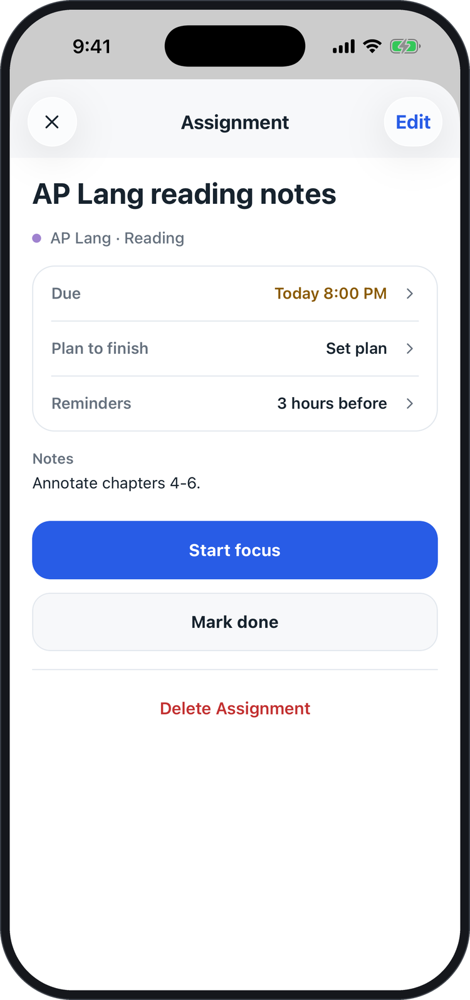

# NotCooked

A student-first planner that turns scattered coursework into a clear next step.

**Status:** currently in private beta. NotCooked's source code is private; this repository contains documentation and screenshots only. All screenshots use fictional demo data.

## The problem

- Assignments are scattered across systems: a learning platform, Google Classroom, a teacher's announcement, a photo of a worksheet.
- Long overdue lists create noise. When everything is flagged, nothing stands out.
- Students need help choosing what to do next, not another place to store everything.

## What NotCooked does

NotCooked answers one question: what do I need to do right now? Three screens, each with one job:

- **Today** is for immediate work. It recommends a next task, shows why, and lists what is due today and what you planned for today.
- **Plan** is for dated work. A week and month view with due counts, and a place to set when you will do something.
- **Schoolwork** is the full inventory, including undated work, organized by due date, by course, or by what you added recently.

## Features

- **Imports from Canvas and Google Classroom.** Canvas through your school calendar link, Google Classroom through a read-only connection. Nothing is saved until you review it.
- **Capture from text, files and photos.** Paste a syllabus or announcement, upload a file, or photograph a worksheet, then check the results before they are added.
- **Next-task recommendations.** Today picks a next task and shows the reasons behind the choice.
- **Focus sessions.** Choose a task and a session length, then work against a timer.
- **Due dates and courses.** Color-coded courses, due times, estimated time and notes for every assignment.
- **Completion with Undo.** Mark work done, and take it back if you tapped too soon.
- **Reminders and planning tools.** Reminders before work is due, a plan date for each assignment, and an optional AI planning suggestion that you opt into and can turn off, with a basic plan as the alternative.

## Screenshots

<table>
  <tr>
    <td align="center" width="33%"> Today</td>
    <td align="center" width="33%"> Plan</td>
    <td align="center" width="33%"> Schoolwork</td>
  </tr>
  <tr>
    <td align="center" width="33%"> Schoolwork by course</td>
    <td align="center" width="33%"> Import options</td>
    <td align="center" width="33%"> Import review</td>
  </tr>
  <tr>
    <td align="center" width="33%"> Focus setup</td>
    <td align="center" width="33%"> Focus timer</td>
    <td align="center" width="33%"> Assignment details</td>
  </tr>
</table>

## Beta testing

NotCooked has been beta-tested with 25+ students and has been iterated using their feedback.

## Technology

NotCooked is an Expo (React Native) app that uses Firebase for authentication and data. Sensitive credentials, such as the connection to Google Classroom, are kept in the device's secure storage. The core logic is covered by automated tests.

## More

- [PRODUCT.md](PRODUCT.md): what NotCooked is for and how it is designed.
- [PRIVACY.md](PRIVACY.md): how NotCooked handles student data.

## Author

Created by Julian Gonzalez, founder and developer. [GitHub profile](https://github.com/juliangonzalez-tech)

## Copyright

© 2026 Julian Gonzalez. All rights reserved. The NotCooked name, brand and the screenshots in this repository may not be reused without permission. NotCooked's source code is private and is not licensed for use.
